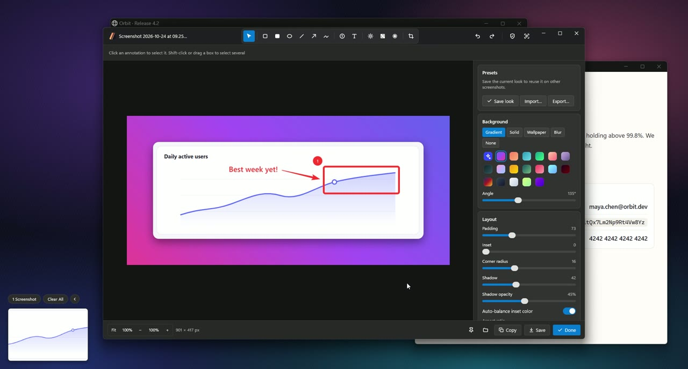
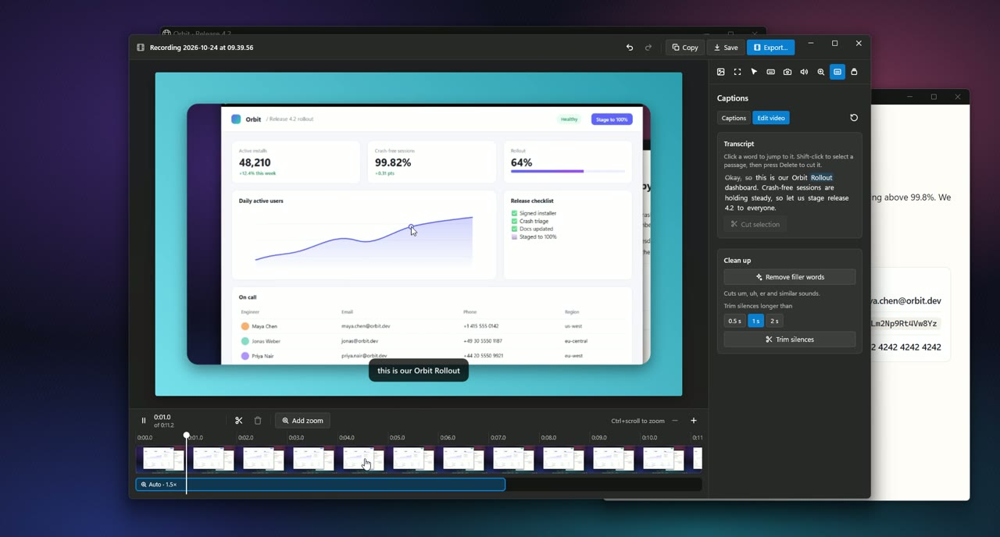

# Glint

A free, open-source Snipping Tool alternative for Windows 10 and 11.

[Download for Windows](https://github.com/wobsoriano/glint/releases/latest)

### Screenshots

[](docs/media/screenshots-demo.mp4)

### Screen recording

[](docs/media/recording-demo.mp4)

## Why not just use Snipping Tool?

Snipping Tool is fine for a quick screenshot, and it records the screen too. Its job ends at the capture. Glint covers what comes after:

- A screenshot you share usually needs arrows, a label and a background. Glint does all of that in one editor, and you can reopen the capture next week and still move the arrows.
- Screenshots of real work leak emails, API keys and card numbers. Glint finds them and hides them before you share.
- A raw screen recording is hard to follow. Glint zooms in where you click, redraws the cursor larger, adds captions from an on-device transcript, and cuts the video when you delete words from that transcript.
- Every screenshot and recording lands in a searchable Library instead of a folder of files named `Screenshot (214).png`.

Glint runs entirely on your PC. It has no account, no cloud upload and no telemetry, and it is MIT licensed.

## Glint vs. Snipping Tool

| | Snipping Tool | Glint |
| --- | --- | --- |
| Area, window and full-screen screenshots | Yes, plus freeform, and a 3, 5 or 10 s delay | Yes, plus a 3, 5 or 10 s self-timer, and capturing the previous area again |
| Annotate | Pen, highlighter, rectangles, ovals, lines and arrows | Arrows, shapes, numbered markers, text, highlight, pixelate and blur, all editable later |
| Styled screenshots | No | Gradient, image or wallpaper backgrounds, padding, corners, shadow, saved presets |
| Hide sensitive text | Emails and phone numbers | Emails, phone numbers, card numbers, API keys, IP addresses and tokens, automatically |
| Copy text from the screen | Yes | Yes |
| Captures you can reopen and re-edit | No | The Library: search, sort, Quick Look, and non-destructive edits |
| Preview cards and pins | No | A card stack you can drag into other apps, and always-on-top pins |
| Screen recording with audio | Yes | Yes, plus camera and keyboard and mouse input on separate tracks |
| Auto zoom that follows your clicks | No | Yes |
| Cursor, camera bubble and keystroke captions | No | Redrawn and adjustable after recording |
| Edit a recording | Trim the ends, and export a GIF of up to 30 s | Built-in Studio: cut, trim, speed, styled frame, export at 60 fps |
| Captions and transcript editing | No | On-device transcription, captions, cut by deleting words, remove filler words and silences |
| Teleprompter | No | Scrolls with your voice |

Snipping Tool also does things Glint doesn't: freeform snips, QR code detection, a color picker, copying a table as a table, and Perfect Screenshot framing on Copilot+ PCs. Its features change with Windows updates, and this table describes it as of late 2026. Glint is not affiliated with Microsoft. Snipping Tool is a Microsoft product.

Glint lives in the notification area and supports Windows only for now. It is written in Go with [MyGo](https://mygo.egoist.dev), whose native UI draws on the GPU. Text recognition uses the Windows OCR engine, and whisper.cpp transcribes on your PC.

## Install

Download `Glint-<version>-windows-x64-setup.exe` from [Releases](https://github.com/wobsoriano/glint/releases) and run it. The installer needs no administrator rights. It installs Glint for your user in `%LOCALAPPDATA%\Programs\Glint`, and Settings > Apps uninstalls it.

Releases are not code-signed yet, so Windows SmartScreen may show "Windows protected your PC" the first time. Click **More info**, then **Run anyway**. See [Code signing policy](#code-signing-policy).

## Features

### Capture

- Capture the full screen, a window, or an area. The area overlay shows a magnifier and the selection size. Space switches between area and window mode, and Esc cancels.
- Capture the previous area again.
- Self-timer of 3, 5 or 10 seconds, started from the tray menu.
- Capture Text copies the text in an area to the clipboard in reading order and saves nothing.
- Save as PNG, or as JPEG with a quality setting. **Save** can write straight to the export folder or ask where to save.
- Window captures can get a drop shadow.
- Glint's own windows stay out of screenshots unless you turn on **Include Glint windows in screenshots**.
- Optional automatic redaction finds emails, phone numbers, card numbers, API keys, IP addresses and tokens in URLs, and hides them as editable annotations.

### After a capture

- Choose what happens after each screenshot: show a preview card, copy, save, open the editor, pin. Any combination works.
- Choose what happens after each recording: show a preview card, copy the video, save, open Studio.
- Preview cards stack on the left or right edge of the screen. They close after a delay you set, or stay until you dismiss them. A collapsed stack becomes a small tab.
- Card actions are copy, save, compress to JPEG, pin, Quick Look, edit, copy text, delete and dismiss. Drag a card into another app to drop the file there. You can move the actions between the four corners, the center and the overflow menu in **Settings > Overlay**.
- When a save fails, a dialog offers **Retry** or another folder.

### Library

- Filter by all captures, screenshots or recordings. Switch between grid and list, search by title, and sort by date captured, name or date modified.
- The inspector shows size, dates, duration, disk usage and location.
- Quick Look opens on double-click or Space.
- Select several items with Ctrl-click, Shift-click or Ctrl+A, then copy, export, show them in Explorer, or move them to the Recycle Bin.
- Press Enter to rename a capture.
- The installer registers **Open with Glint** for images and videos. An image opens in the editor as an imported copy. A video opens in Trim & Compress.

### Annotation editor

- Edits are non-destructive. The original pixels stay in the capture, the edit is stored beside them, and reopening the capture restores every annotation.
- Tools are select, rectangle, filled rectangle, ellipse, line, arrow, freehand, numbered markers, text, highlight, pixelate and blur.
- Crop presets are freeform, original, 1:1, 16:9, 9:16, 4:3 and 3:2. Cropping moves the annotations with the image and can be undone.
- Backgrounds can be a solid color, a gradient, an image or the desktop wallpaper. You can also set padding, corner radius, shadow, border, aspect ratio, alignment, a text watermark, perspective and rotation, and a progressive blur.
- Save styles as presets, and import or export them as `.glintpreset` files.
- **Copy**, **Save** and **Done** each save the edit into the capture. **Save** also exports a copy, and **Done** closes the editor. If the edit cannot be saved, the editor stays open with your changes.
- Pin any image as an always-on-top window.

### Screen recording

- The recording picker chooses a display, a window or an area, plus a camera, a microphone and system audio. It also sets a start timer of 1, 3 or 5 seconds and an optional teleprompter script.
- A missing camera or microphone produces a warning, and the recording continues without it.
- A control bar shows the elapsed time and has pause, restart, stop and delete.
- Glint records the screen without the cursor, plus separate camera, microphone, system audio and input tracks. Studio redraws the cursor from the input track.
- The teleprompter scrolls with your voice when a microphone is on.

### Recording Studio

- Cut the recording on a timeline: split, trim, delete, and set the speed per clip, with undo and redo.
- Style the frame with a background, padding, corner radius and shadow. Pick an aspect ratio, and crop the screen.
- Auto zoom follows clicks. You can add, remove, resize and retime zooms.
- The cursor can be resized and can highlight clicks. Keystroke captions can sit in six positions.
- Show, move, resize and round the camera bubble.
- Transcribe on the device, edit captions, and cut the video by deleting words from the transcript. Filler words and silences can be removed in one step.
- Export as MP4 at 30 or 60 fps with a quality and resolution setting, optional motion blur, a progress bar and cancel.
- Trim & Compress trims and shrinks any MP4, MOV or M4V file.

## Default shortcuts

These are global shortcuts. Change them in **Settings > Shortcuts**.

| Shortcut | Action |
| --- | --- |
| `Ctrl+Shift+4` | Capture area |
| `Ctrl+Shift+3` | Capture full screen |
| `Ctrl+Shift+5` | Capture window |
| `Ctrl+Shift+6` | Capture previous area |
| `Ctrl+Shift+2` | Capture text |
| `Ctrl+Shift+7` | Record screen, or stop the recording in progress |
| `Ctrl+Shift+L` | Open Library |

Double-click the tray icon to capture an area.

In the editor, `Ctrl+C` copies, `Ctrl+S` saves, `Ctrl+Shift+S` saves through a dialog, `Ctrl+Enter` is **Done**, and `Ctrl+P` pins. `Ctrl+Z` undoes and `Ctrl+Y` redoes. Single letters pick a tool: `V` select, `R` rectangle, `F` filled rectangle, `O` ellipse, `L` line, `A` arrow, `P` freehand, `N` marker, `T` text, `H` highlight, `X` pixelate, `B` blur, `C` crop. `Ctrl+1` fits the image and `Ctrl+0` shows it at actual size.

## Command line

```
glint.exe [--background] [--library] [--record] [--capture area|window|screen|text|previous]
          [--studio <session dir>] [--trim <video>] [image, video or Library capture...]
```

| Argument | Effect |
| --- | --- |
| no arguments | Opens the Library. |
| `--background` | Starts in the tray without opening a window. **Launch at login** uses this flag. |
| `--library` | Opens the Library. |
| `--record` | Opens the recording picker, or stops the recording in progress. |
| `--capture <kind>` | Starts a capture. `<kind>` is `area`, `window`, `screen`, `text` or `previous`. |
| `--studio <dir>` | Opens a recording session folder in Studio. |
| `--trim <video>` | Opens a video in Trim & Compress. |
| a file path | Opens an image in the editor, or a video in Trim & Compress. |

Only one Glint runs at a time. A second `glint.exe` sends its arguments to the running instance and exits.

## Build

You need Go 1.27 or later and nothing else: no cgo, no C compiler, no Windows SDK.

```
go run .                    # run from source
go tool mygo build          # build Glint.exe and the installer into build/windows-amd64/
```

`docs/building.md` covers tests, packaging, code signing and releases. Glint does not need ffmpeg.

Transcription downloads whisper.cpp 1.8.3 and its model the first time you use it. whisper.cpp needs the [Visual C++ runtime](https://aka.ms/vc14/vc_redist.x64.exe), which most Windows PCs already have. Glint tells you if it is missing.

## Data locations

| Path | Contents |
| --- | --- |
| `%APPDATA%\Glint\settings.json` | Settings |
| `%APPDATA%\Glint\Library\` | One folder per capture. See `docs/architecture.md` for the format. |
| `%APPDATA%\Glint\presets.json` | Editor presets |
| `%APPDATA%\Glint\models\` | Downloaded whisper models and the whisper.cpp runtime |
| `%USERPROFILE%\Pictures\Glint\` | Default export folder |

Set `GLINT_DATA_DIR` to use another folder in place of `%APPDATA%\Glint`.

## Code layout

| Package | Contents |
| --- | --- |
| `main.go`, `internal/app` | Start-up, single instance, tray, global shortcuts, the capture flow, and the wiring between windows |
| `internal/ui/...` | One package per window: `overlay`, `stack` (preview cards), `editor`, `pin`, `quicklook`, `library`, `prefs`, `record`, `studio`, `trim`, `toast`, plus `theme` |
| `internal/actions` | Copy, save, export, compress and delete, shared by every window |
| `internal/platform`, `internal/ocr` | Screen and window capture, capture exclusion, launch at login; the Windows OCR engine |
| `internal/settings`, `internal/store`, `internal/redact` | `settings.json` and presets, the Library on disk, sensitive-text detection |
| `internal/render` | CPU compositor for styles, backgrounds and annotations, shared by the editor and Studio |
| `internal/media` | Screen, camera, audio and input recording; MP4 encoding and decoding; audio playback |
| `internal/studio` | Studio project model, timeline, auto zoom, frame compositor and export |
| `internal/transcribe` | whisper.cpp transcription, captions, filler words and silence detection |

Only `internal/app`, `internal/actions` and `internal/ui/...` import MyGo, so the other packages' tests run without a window. `docs/architecture.md` describes the on-disk formats. `docs/parity.md` is the feature checklist with evidence for each item.

## Tests

```
go test ./...
```

Run them from a signed-in desktop session, because some tests capture the screen or play sound. `go test -short ./...` skips those. `docs/building.md` lists the other markings.

## Privacy

Glint has no accounts, analytics or telemetry, and never uploads your captures. It connects to the network only when you ask for transcription, to download the whisper.cpp runtime from [its GitHub releases](https://github.com/ggml-org/whisper.cpp/releases) and the model you pick from [Hugging Face](https://huggingface.co/ggerganov/whisper.cpp). The runtime is checked against a pinned SHA-256 hash, and the model against its published size.

## Code signing policy

Windows releases will be signed through [SignPath Foundation](https://signpath.org)'s free code signing for open-source projects, with a certificate issued to SignPath Foundation. The application is pending, and until it is accepted, releases are unsigned.

Only binaries that the [Release workflow](.github/workflows/release.yml) builds from this repository are signed, and every signing request is approved by hand.

| Role | Members |
| --- | --- |
| Committers and reviewers | [@wobsoriano](https://github.com/wobsoriano) |
| Approvers | [@wobsoriano](https://github.com/wobsoriano) |

This program will not transfer any information to other networked systems unless specifically requested by the user or the person installing or operating it. See [Privacy](#privacy).

## License

[MIT](LICENSE)

## Inspired by

The feature set is inspired by [Screendrop](https://github.com/fayazara/Screendrop) by Fayaz Ahmed, which is released under CC0. The interaction patterns are inspired by [CleanShot X](https://cleanshot.com). Glint shares no code or assets with either app.
